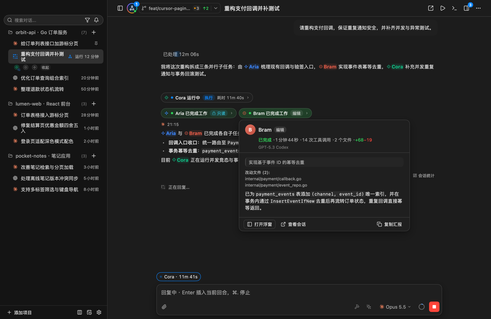
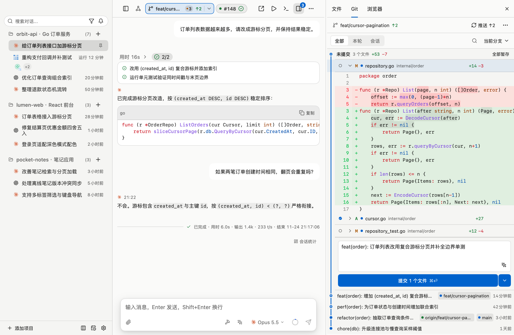
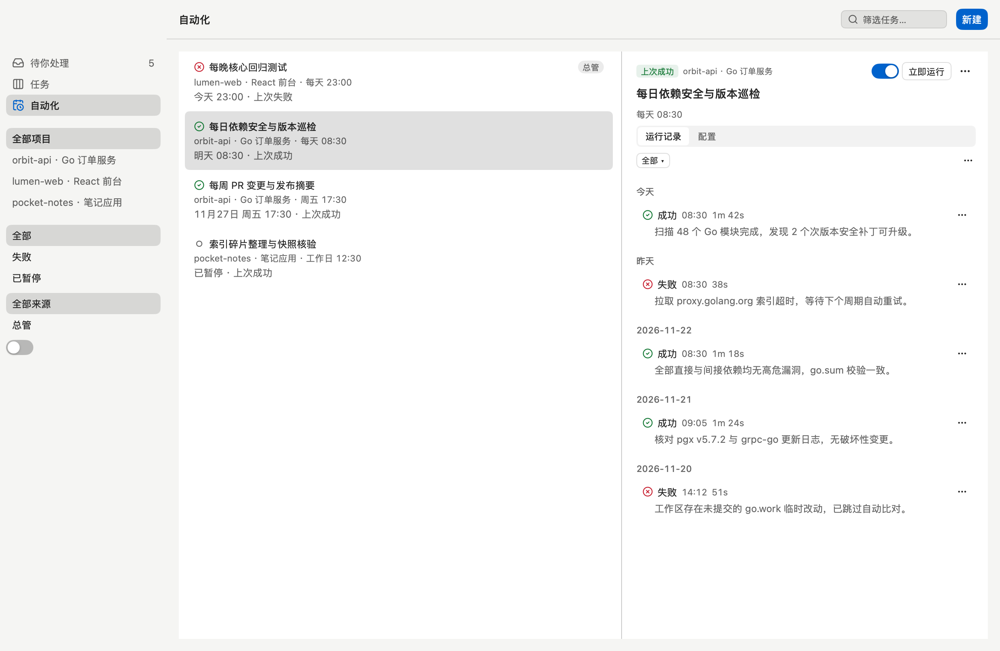
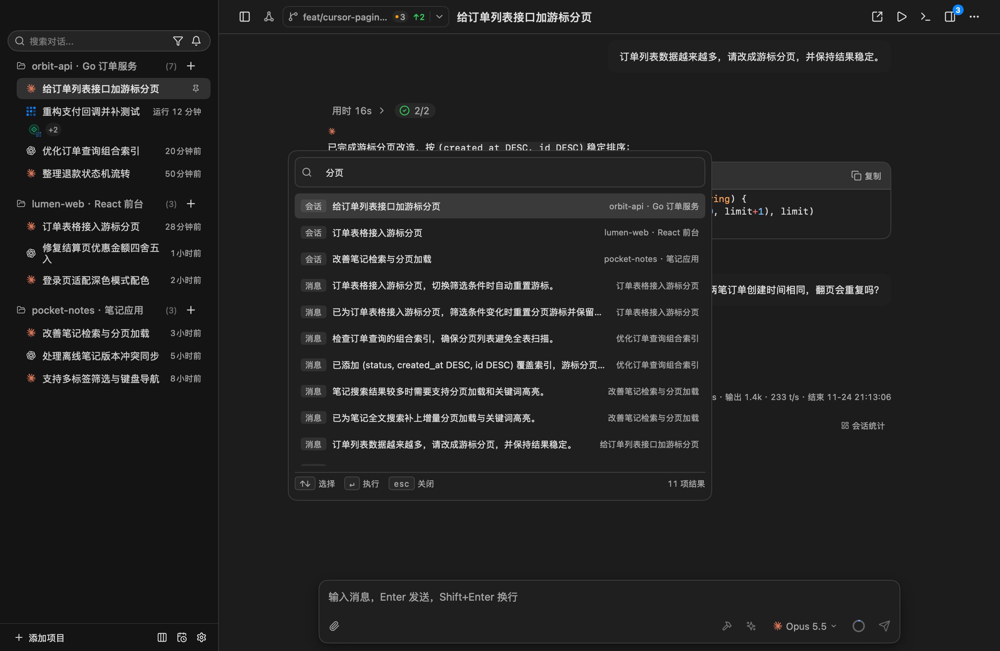
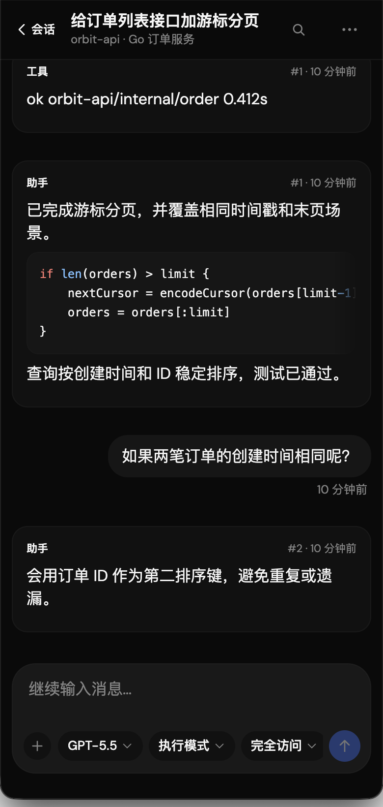

# MCode

MCode 是一款 AI 编码桌面客户端，用一个窗口管理多个 AI coding agent 线程：会话时间线、Composer、设置、看板、编排与子代理都在原生窗口内完成。

<picture>
  <source media="(prefers-color-scheme: dark)" srcset="docs/images/hero-dark.png">
  
</picture>

桌面端由纯 Go 实现，不依赖 cgo，界面使用 GPU 原生的 MyGo 框架绘制，因此长会话的高频流式输出与多线程并发交互仍能保持流畅。仓库同时附带一个自写的 Web 远程控制端（`web/`，React + TypeScript），在手机或另一台机器的浏览器里接管同一批会话，协议见 `docs/remote-control.schema.json`。

## 功能一览

### 编排与子代理

### 子代理浮窗

### Git 与 PR

### MoCo · 总管

### 看板与自动化

### 跨会话搜索

### 手机远程控制

## 当前状态

**平台**：以 macOS（14.0+）为主要支持平台；Windows 为尽力支持，主要功能可用，但发布前不做完整验证，平台相关问题按优先级处理。

已实现并具备以下能力：
- **Provider**：Claude Code、Codex、Antigravity（`agy`）三个主力 provider；Copilot、Pi、OMP、Command Code 等 CLI agent；经 ACP 接入的 Droid、Cline、Cursor、OpenCode、Grok、Devin；Anthropic、OpenAI、DeepSeek、Z.ai、Meta 等 API 来源与自定义端点（含 Magpie 网关）；支持多账号路由、额度与费用展示；
- **Go 后端**：`store`、`config`、`git`、`providers`、`remote`（JSON-RPC/WebSocket）、`harness`、`kanban`、`automation`、`swarm`（编排）、`mcp`、`nmem`（Nowledge 记忆）、`projctx`、`native`（通知/托盘/快捷键/提示音/keyring）、`frontdesk`（MoCo · 总管前台）、`localmem`（本地记忆）、`reviewcheck` / `reviewfunnel`（编排合并审查）、`apisource`（API 来源解析）、`backup`（加密配置备份）；
- **原生 UI**：外壳（`internal/ui`）、聊天时间线、Composer、设置、看板、编排面板与子代理浮窗、MoCo · 总管与任务窗口、自动化、记忆、额度与用量面板、待处理收件箱、终端、文件管理器、Web 预览、Git 变更与 PR 查看、跨会话消息搜索；
- **Web 远程前端**：`web/` 独立前端与 `internal/webassets` 内嵌静态资源。

## 目录结构

| 路径 | 说明 |
| :--- | :--- |
| `cmd/mcode/` | 桌面端入口 |
| `cmd/mcode-server/` | 远程控制服务入口 |
| `internal/` | Go 后端与原生 UI（`ui`、`store`、`providers`、`remote`、`swarm` 等） |
| `web/` | React + TypeScript 远程控制前端 |
| `scripts/` | 检查、打包、发布与开发辅助脚本 |
| `resources/` | 图标、字体、entitlements 等内嵌资源 |
| `docs/` | 使用引导、开发文档、远程控制协议与第三方组件说明 |
| `.github/` | 发布工作流 |

## 文档

| 文档路径 | 说明 |
| :--- | :--- |
| [docs/user-guide.md](docs/user-guide.md) | 新用户使用引导：安装、配置智能体、对接 Magpie 网关 |
| [docs/agent-install.md](docs/agent-install.md) | 给 AI agent 执行的安装与配置步骤 |
| [docs/dev/README.md](docs/dev/README.md) | 开发文档：各子系统的功能、实现方式和代码入口 |
| [docs/remote-control.schema.json](docs/remote-control.schema.json) | 远程控制协议的机器可读契约（JSON-RPC 2.0） |
| [docs/remote-control-protocol.md](docs/remote-control-protocol.md) | 远程控制协议说明，含 Web Push 离线推送 |
| [docs/THIRD_PARTY_NOTICES.md](docs/THIRD_PARTY_NOTICES.md) | 第三方组件与资源许可清单 |
| [CHANGELOG.md](CHANGELOG.md) | 版本更新说明，也是发布正文 |

## 开发

- **Go 版本要求**：Go 1.27.3
- **开发运行**：`go tool mygo dev`
- **依赖检查**：`scripts/check-deps.sh`
- **统一检查**：`scripts/check.sh`，依次执行 gofmt、构建、go vet、依赖检查、单元测试、前端类型检查和前端测试；加 `--race` 时额外运行 race 测试。会自动排除被 git 忽略的打包产物目录 `build.noindex/` 与 `dist/`。
- **发布打包**：`scripts/package_release.sh`
- **个人分发打包**：`scripts/package_personal.sh`，有证书时用 Developer ID 签名、否则临时签名，不做公证，安装到 /Applications 后默认重启；支持 `--clean`、`--bump`、`--dmg`、`--windows`、`--no-relaunch`
- **Windows 个人打包**：`scripts/package_windows.ps1`，构建 Web 与 Windows 安装程序，默认静默覆盖安装并重启，支持 `-Clean`、`-Bump`、`-NoRelaunch`
- **数据与日志**：数据目录默认 `~/.mcode`（优先级依次为 `-data`、`MCODE_DATA`、设置里选择的目录），日志在 `<数据目录>/logs`（`mcode.log`、`startup.log`、`crash.log`）
- **调试**：`MCODE_PPROF=host:port` 启动 pprof 服务（仅绑定本机回环地址），用 `go tool pprof http://<host>:<port>/debug/pprof/profile` 抓 CPU profile；`MCODE_STARTUP_TRACE=1` 记录启动各阶段耗时到 `<数据目录>/logs/mcode.log`（搜 `startup:`）
- **测试**：`go test -timeout 60s ./...`、`go test -race -timeout 120s ./...`（显式超时，避免 UI 死锁时空等默认的 10 分钟）
- **更新截图**：`MCODE_README_SHOTS=1 go test -timeout 600s -run TestReadmeShots ./internal/ui`，用 headless 渲染把 README 截图写入 `docs/images/`；`swarm-floats.png` 是实机截图、`remote-web.png` 是 Web 端截图，两张都不在这条命令的范围内

## 发布

在 main 分支且工作区干净时，运行 `scripts/release.sh [patch|minor|major|版本号] [--notes 文件] [--dry-run]`。不指定 `--notes` 时，脚本使用 `.env` 中 `MCODE_RELEASE_AGENT` / `MCODE_RELEASE_MODEL` 配置的本地 agent（默认 claude），根据上一个标签以来的提交生成中文亮点，显示后确认（Enter 或 y 使用、e 编辑、n 取消，60 秒无输入自动使用；非终端环境不询问）；AI 失败时回退到提交标题。说明写入 `CHANGELOG.md` 的 `## 版本号` 下，同时更新 `mygo.json` 的版本号并推送标签。

工作流构建 macOS（arm64 / amd64）与 Windows（amd64）产物，将该章节作为发布正文；macOS 未公证时追加 Gatekeeper 提示，Windows 版未签名，追加 SmartScreen 提示。

如果推送标签未触发工作流，运行 `gh workflow run release.yml --ref v<版本号>`。

必需密钥：`MYGO_UPDATER_PRIVATE_KEY`。Developer ID 签名需要 `MACOS_CERTIFICATE`、`MACOS_CERTIFICATE_PASSWORD`、`MACOS_SIGN_IDENTITY`；公证还需要 `APPLE_ID`、`APPLE_TEAM_ID`、`APPLE_APP_PASSWORD`。

## 编排（主代理 / 子代理）

开启会话的编排后，主代理轮次结束时会解析回复中的 `swarm` JSON 代码块并派发子代理；主代理也可用 `swarm_delegate` 工具即时派发（`orchestration.delegate_tool`，默认开启）。默认关闭审查、子代理汇报后自动合入；可在设置里把 `orchestration.review_mode` 改成 `ai`（由只读审查会话自动判断）或 `human`（在编排面板人工批准或放弃），审查有结论后才把 `[编排] 子代理汇报` 交给主代理，普通跟进消息等待审查及汇报轮次结束。

派发条目可带 `acceptance` 验收命令，子代理汇报后在其副本里执行，全部退出 0 才合入。`orchestration` 段的其他常用键：`max_bees`（并发上限）、`max_rounds`（轮次上限）、`bee_timeout_minutes`（单个子代理超时）、`request_timeout_minutes`（单次请求的编排时长）、`workspace_mode`（`worktree` 或 `shared`）、`tiers` / `default_tier`（子代理档位）。

子代理状态保存在数据目录的 `mcode.db` 中；重启后仍在运行的子代理会标为中断，不会自动合并半成品。

在数据目录的 `config.json` 的 `orchestration` 段设置 `always_bees: true`（默认 `false`），可将直接发送的纯文本消息交给子代理，`threads.queue.interruptAndSend` 此时返回 `sent_to_swarm`。该键由旧的 `general.swarm_send_to_bees` 自动迁移而来，改完无需重启，下一次解析会话模式时即生效（会话显式选了其他模式时仍以会话设置为准）；该选项默认关闭，仅对已开启编排的主会话生效；显式排队消息、附件消息、`/` 命令和 `[编排]` 通知（兼容旧的 `[Hydra]` 前缀）仍走主会话。

## 致谢

MCode 的开发灵感来自 Droppy Code。它把多个 AI coding agent 会话集中到同一个桌面窗口里管理，这个思路启发了 MCode：在此基础上，MCode 进一步追求超长会话和多会话并发时依然流畅的体验。

MCode 是独立实现，不包含 Droppy Code 的源代码或资源。

## 许可证

本项目以 [Apache License 2.0](LICENSE) 授权，版权归属见 [NOTICE](NOTICE)。所用第三方组件及其许可证见 [docs/THIRD_PARTY_NOTICES.md](docs/THIRD_PARTY_NOTICES.md)。
