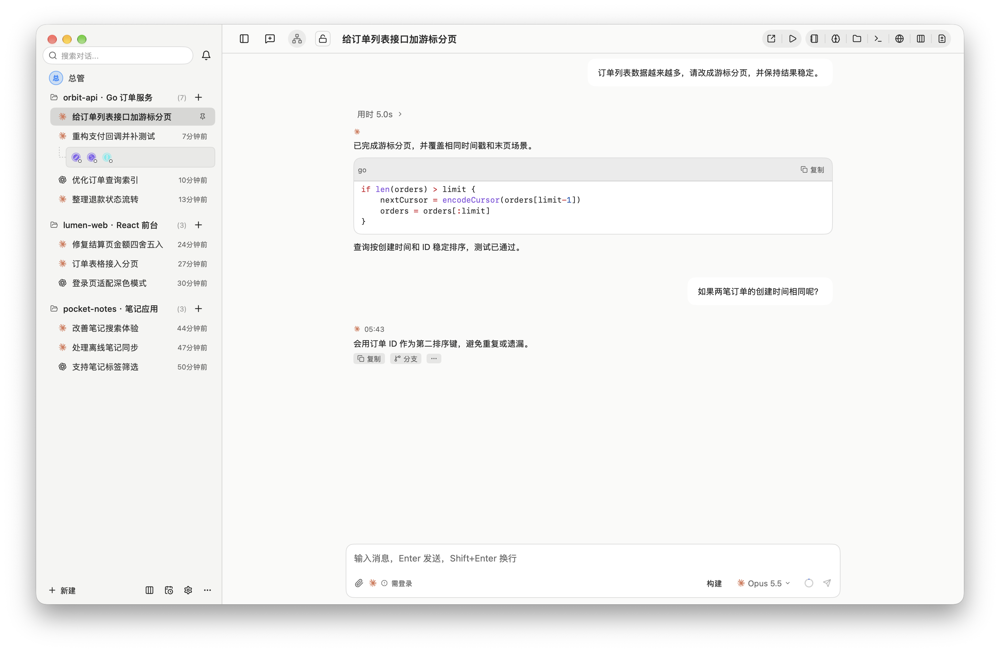
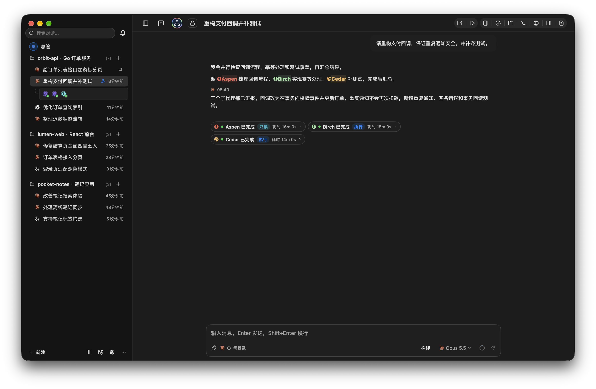
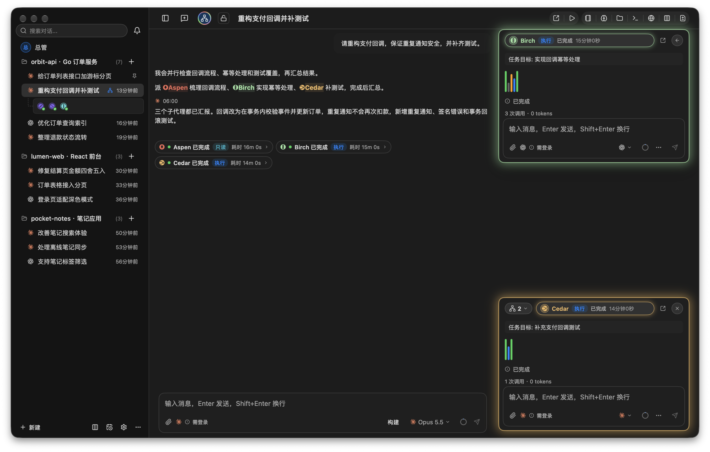
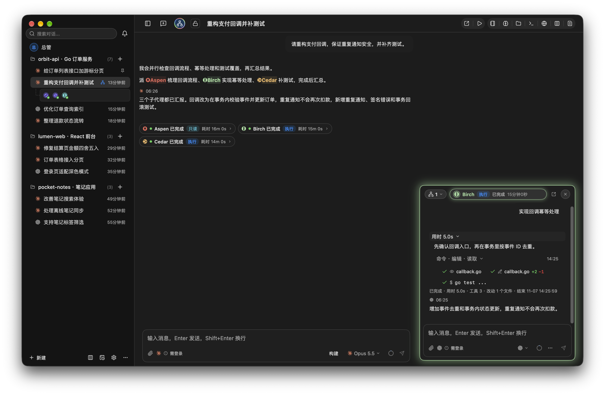
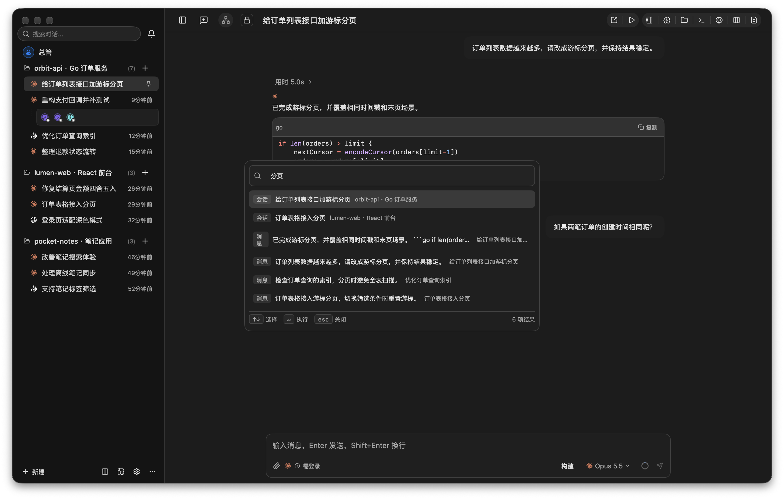
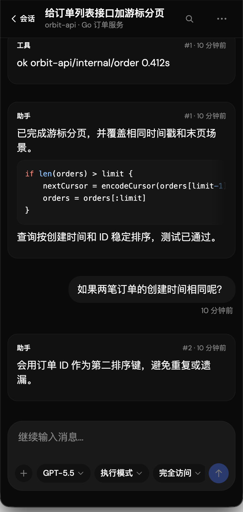

# MCode

MCode 是一款 AI 编码桌面客户端，用一个窗口管理多个 AI coding agent 线程：会话时间线、Composer、设置、看板、编排与子代理都在原生窗口内完成。

<picture>
  <source media="(prefers-color-scheme: dark)" srcset="docs/images/hero-dark.png">
  
</picture>

桌面端由纯 Go 实现，不依赖 cgo，界面使用 GPU 原生的 MyGo 框架绘制，因此长会话的高频流式输出与多线程并发交互仍能保持流畅。仓库同时附带一个自写的 Web 远程控制端（`web/`，React + TypeScript），在手机或另一台机器的浏览器里接管同一批会话，协议见 `docs/remote-control.schema.json`。

## 功能一览

### 编排与子代理

### 子代理浮窗

### 跨会话搜索

### 手机远程控制

## 当前状态

**平台**：以 macOS（14.0+）为主要支持平台；Windows 为尽力支持，主要功能可用，但发布前不做完整验证，平台相关问题按优先级处理。

已实现并具备以下能力：
- **Provider**：Claude Code、Codex、Antigravity（`agy`）三个主力 provider，以及 Copilot、Pi、OMP、Command Code、Droid、Cline、Cursor、OpenCode、Grok、Devin 等 CLI agent（部分经 ACP 接入）、OpenAI 兼容 API 端点与 Magpie 网关；支持多账号路由、额度与费用展示；
- **Go 后端**：`store`、`config`、`git`、`providers`、`remote`（JSON-RPC/WebSocket）、`harness`、`kanban`、`automation`、`swarm`（编排）、`mcp`、`nmem`（Nowledge 记忆）、`projctx`、`native`（通知/托盘/快捷键/提示音/keyring）；
- **原生 UI**：外壳（`internal/ui`）、聊天时间线、Composer、设置、看板、编排面板、终端、Git 变更与 PR 查看、跨会话消息搜索；
- **Web 远程前端**：`web/` 独立前端与 `internal/webassets` 内嵌静态资源。

## 目录结构

| 路径 | 说明 |
| :--- | :--- |
| `cmd/mcode/` | 桌面端入口 |
| `cmd/mcode-server/` | 远程控制服务入口 |
| `internal/` | Go 后端与原生 UI（`ui`、`store`、`providers`、`remote`、`swarm` 等） |
| `web/` | React + TypeScript 远程控制前端 |
| `scripts/` | 依赖检查与打包脚本 |
| `resources/` | 图标、字体等内嵌资源 |
| `docs/` | 远程控制协议与第三方组件说明 |

## 文档

| 文档路径 | 说明 |
| :--- | :--- |
| [docs/user-guide.md](docs/user-guide.md) | 新用户使用引导：安装、配置智能体、对接 Magpie 网关 |
| [docs/dev/README.md](docs/dev/README.md) | 开发文档：各子系统的功能、实现方式和代码入口 |
| [docs/remote-control.schema.json](docs/remote-control.schema.json) | 远程控制协议的机器可读契约（JSON-RPC 2.0） |
| [docs/remote-control-protocol.md](docs/remote-control-protocol.md) | 远程控制协议说明，含 Web Push 离线推送 |
| [docs/THIRD_PARTY_NOTICES.md](docs/THIRD_PARTY_NOTICES.md) | 第三方组件与资源许可清单 |

## 开发

- **Go 版本要求**：Go 1.27.3
- **开发运行**：`go tool mygo dev`
- **依赖检查**：`scripts/check-deps.sh`
- **统一检查**：`scripts/check.sh`，依次执行 gofmt、构建、go vet、依赖检查、单元测试和前端类型检查；加 `--race` 时额外运行 race 测试。会自动排除被 git 忽略的打包产物目录 `build.noindex/` 与 `dist/`。
- **发布打包**：`scripts/package_release.sh`
- **个人分发打包**：`scripts/package_personal.sh`，用 Developer ID 签名、不做公证，构建产物安装到 /Applications，支持 `--clean`、`--dmg`、`--relaunch`
- **数据与日志**：数据目录默认 `~/.mcode`（`MCODE_DATA` 或 `-data` 可改），日志在 `<数据目录>/logs`（`mcode.log`、`startup.log`、`crash.log`）
- **测试**：`go test -timeout 60s ./...`、`go test -race -timeout 120s ./...`（显式超时，避免 UI 死锁时空等默认的 10 分钟）

## 编排（主代理 / 子代理）

开启会话的编排后，主代理轮次结束时会解析回复中的 `swarm` JSON 代码块并派发子代理。默认关闭审查、子代理汇报后自动合入；可在设置里把 `orchestration.review_mode` 改成 `ai`（由只读审查会话自动判断）或 `human`（在编排面板人工批准或放弃），审查有结论后才把 `[编排] 子代理汇报` 交给主代理，普通跟进消息等待审查及汇报轮次结束。

子代理状态保存在数据目录的 `mcode.db` 中；重启后仍在运行的子代理会标为中断，不会自动合并半成品。

在数据目录的 `config.json` 的 `orchestration` 段设置 `always_bees: true`（默认 `false`），可将直接发送的纯文本消息交给子代理，`threads.queue.interruptAndSend` 此时返回 `sent_to_swarm`。该键由旧的 `general.swarm_send_to_bees` 自动迁移而来，改完无需重启，下一次解析会话模式时即生效（会话显式选了其他模式时仍以会话设置为准）；该选项默认关闭，仅对已开启编排的主会话生效；显式排队消息、附件消息、`/` 命令和 `[编排]` 通知（兼容旧的 `[Hydra]` 前缀）仍走主会话。

## 致谢

MCode 的开发灵感来自 Droppy Code。它把多个 AI coding agent 会话集中到同一个桌面窗口里管理，这个思路启发了 MCode：在此基础上，MCode 进一步追求超长会话和多会话并发时依然流畅的体验。

MCode 是独立实现，不包含 Droppy Code 的源代码或资源。

## 许可证

本项目以 [Apache License 2.0](LICENSE) 授权，版权归属见 [NOTICE](NOTICE)。所用第三方组件及其许可证见 [docs/THIRD_PARTY_NOTICES.md](docs/THIRD_PARTY_NOTICES.md)。
