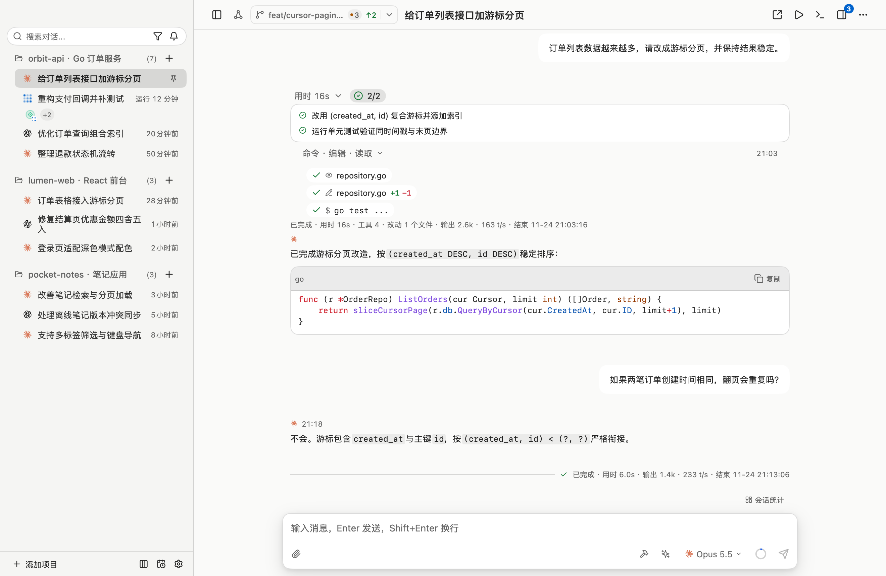
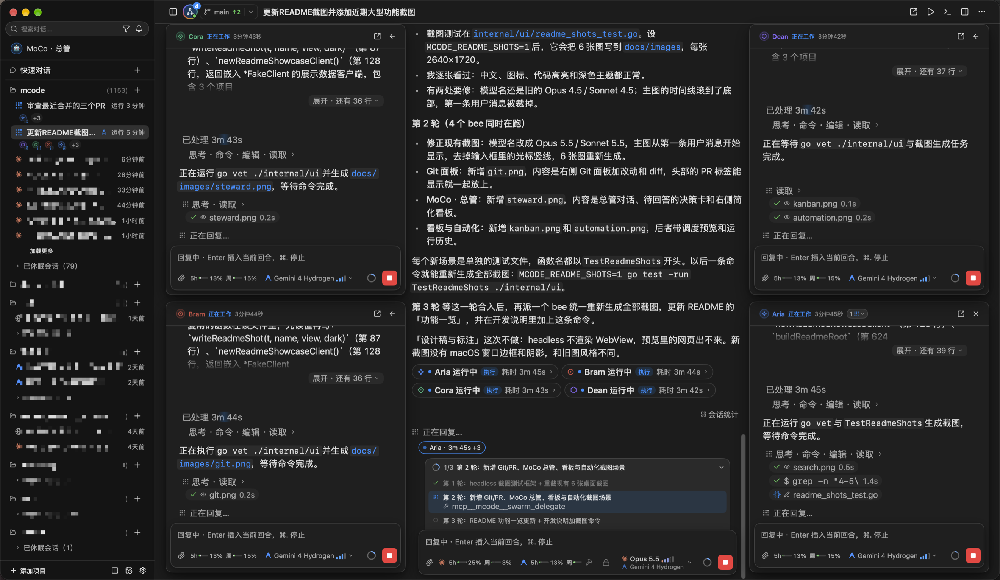
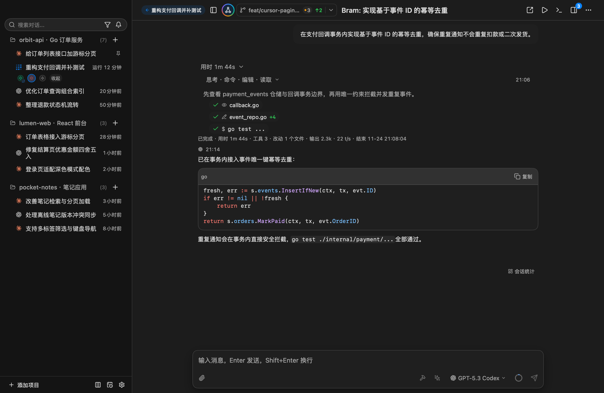
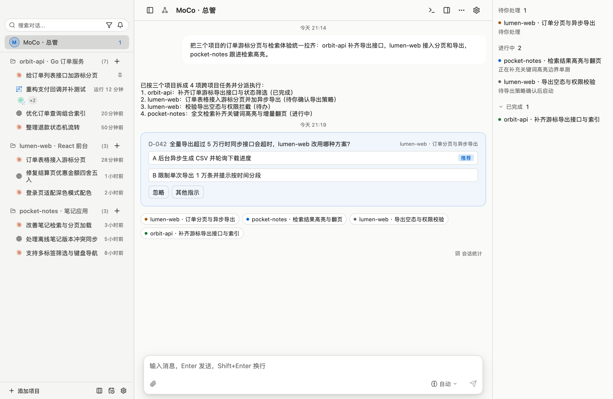
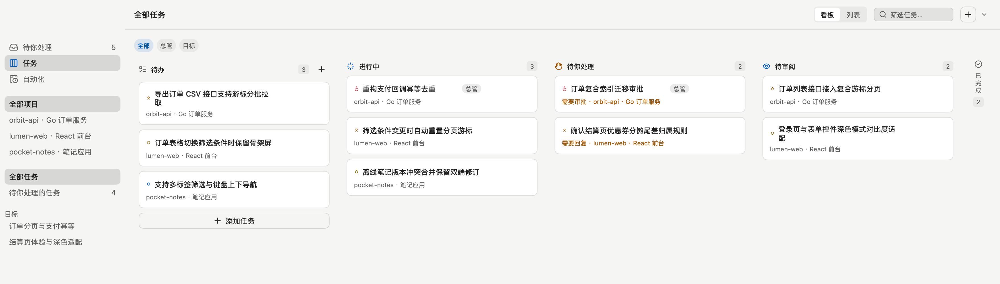

# MCode

MCode 是原生桌面 AI 编码工作台。

它在一个窗口内统一管理多工具会话、跨 Agent 编排、看板目标、定时自动化与手机远程控制。

<picture>
  <source media="(prefers-color-scheme: dark)" srcset="docs/images/hero-dark.png">
  
</picture>

## 核心特色

| 特色 | 带来的价值 |
| :--- | :--- |
| 跨 Agent 编排 | 按任务档位混编模型与工具，互不踩文件，验收审查后再合入 |
| 多工具统一与可控会话 | 统一接入主力 CLI、ACP 与模型 API，支持多账号切换、插队与撤回 |
| MoCo · 总管与「待你处理」 | 总管只统筹调度且先拦截高危操作，所有待办审批集中在一处确认 |
| 看板目标与定时自动化 | 大需求自动拆解执行并验收合并，定时任务按计划运行且阻止系统休眠 |
| 原生桌面工作台 | 长会话与多线程并发保持流畅，代码审阅、终端与全文搜索都在同一窗口 |
| 手机远程控制 | 离开电脑也能用手机同步操作会话与看板，支持离线推送并直接回复审批 |

## 跨 Agent 编排

MCode 支持多模型与多工具协同作业，并全程隔离文件写入。

- **按档位混编与跨项目派发**：内置只读、杂活、执行、攻坚、设计 5 个档位。主代理按档位混用不同模型与工具，并支持跨项目派出子代理。
- **不踩文件的并行隔离**：相同路径的任务自动排队。不同路径的任务在各自隔离区并行运行。
- **自动验收与分级审查**：子代理完成后自动运行验收命令，未通过时自动返工。你可以选择 AI 分级审查或人工批准后再合入。
- **交互式设计定稿**：设计类子代理直接预览 HTML 设计稿，并按你的反馈修改后定稿。
- **浮窗盯进度与重启保护**：独立浮窗实时显示子代理进度。应用意外重启时，MCode 不合入未完成的半成品。

完整配置项与机制见 [docs/reference.md](docs/reference.md)。

## 多工具统一与可控会话

MCode 在同一工作台接入多类 AI 编码工具与模型来源：

- **主力 CLI**：Claude Code、Codex、Antigravity
- **其他 CLI**：Copilot、Pi、OMP、Command Code
- **ACP 工具**：Cline、Cursor、OpenCode、Grok、Devin、Factory Droid
- **内置引擎与 API**：内置引擎、Anthropic、OpenAI、DeepSeek、Z.ai、Meta、自定义端点与 Magpie 网关

会话与账号具备以下控制能力：

- **多账号路由与用量监控**：支持 6 种多账号路由策略与限额冷却。面板集中展示各工具额度、余额与会话费用。
- **插队与队列调整**：运行中随时插队或调整待发队列，支持立即发送、插队、重排、编辑与删除。
- **撤回与异常恢复**：支持撤回回合与按检查点回退文件。会话失效或网络波动时，MCode 自动恢复并重试。

## MoCo · 总管与「待你处理」

MoCo · 总管只读状态并调度看板任务，不直接改代码或推送远端。

触发高危操作时，总管先弹出决策卡请求确认。

「待你处理」收件箱集中呈现 5 类待决事件：

- 会话待审批
- 看板待审批
- 看板待验收
- 目标规划异常
- 设计稿待确认

## 看板目标与定时自动化

把大需求建为目标后，规划器将其拆解为有依赖关系的看板任务。

每个任务在独立工作区执行，通过验收后合并。

定时自动化按计划周期运行并评估结束条件，运行期间自动阻止系统休眠。

## 原生桌面工作台

- **流畅渲染**：客户端采用纯 Go 与 GPU 原生界面绘制，长会话与多线程并发保持流畅。
- **代码审阅与工具集成**：内置统一 Git 与 PR 审阅面板，并集成终端、文件浏览、Mermaid 图表与网页预览。
- **跨会话全文搜索**：在命令面板快速检索所有历史会话中的任意消息并定位跳转。
- **知识与安全能力**：内置项目文档、长期记忆审批、MCP 工具代理与加密配置备份。

## 手机远程控制

用手机浏览器直连桌面端，支持局域网、TLS 与 Tailscale 访问。

手机端同步操作以下内容：

- 会话与编排
- 设计稿预览与定稿
- 看板与 Git
- 实时日志

开启离线推送后，你可以直接在通知里回复审批。

## 快速开始与平台

- **平台支持**：macOS 14.0+ 为主要支持平台；Windows 尽力支持。
- **安装使用**：新用户安装与配置见 [docs/user-guide.md](docs/user-guide.md)；AI Agent 自动安装见 [docs/agent-install.md](docs/agent-install.md)。
- **本地开发**：运行 `go tool mygo dev`（要求 Go 1.27.3），统一检查运行 `scripts/check.sh`。完整开发与发布手册见 [docs/reference.md](docs/reference.md)。

## 文档

| 文档路径 | 说明 |
| :--- | :--- |
| [docs/user-guide.md](docs/user-guide.md) | 新用户指南：包含安装、配置智能体与对接 Magpie 网关 |
| [docs/agent-install.md](docs/agent-install.md) | 供 AI Agent 自动执行的安装与配置步骤 |
| [docs/reference.md](docs/reference.md) | MCode 技术参考：包含术语、子系统规格、目录结构与开发发布流程 |
| [docs/dev/README.md](docs/dev/README.md) | 开发文档（基于 `v0.1.158` 整理；与代码不一致时以代码为准） |
| [docs/remote-control-protocol.md](docs/remote-control-protocol.md) | 远程控制协议说明，包含离线推送 |
| [docs/remote-control.schema.json](docs/remote-control.schema.json) | 远程控制协议的 JSON-RPC 2.0 Schema 契约 |
| [docs/THIRD_PARTY_NOTICES.md](docs/THIRD_PARTY_NOTICES.md) | 第三方组件与资源许可清单 |
| [CHANGELOG.md](CHANGELOG.md) | 版本更新日志与发布正文 |

## 致谢

MCode 的开发灵感来自 Droppy Code。Droppy Code 将多个 AI 编码会话集中到同一桌面窗口。

MCode 在此思路上构建独立实现，并重点优化长会话与多会话并发场景下的性能。

MCode 不包含 Droppy Code 的源代码或资源。

## 许可证

本项目以 [Apache License 2.0](LICENSE) 授权。版权归属见 [NOTICE](NOTICE)。第三方组件与资源的许可证见 [docs/THIRD_PARTY_NOTICES.md](docs/THIRD_PARTY_NOTICES.md)。
