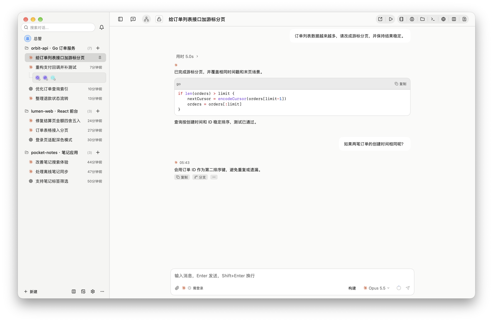

# MCode 使用引导

## 0. 术语

- **智能体**：MCode 调用的 AI 编码 CLI，例如 Claude、Codex、Antigravity、pi。
- **会话**：绑定一个项目和一个智能体的消息记录。
- **回合**：发送一条消息后，智能体完成一次回复的过程。
- **项目**：本机的一个代码文件夹。
- **Magpie 网关**：OpenAI 兼容的模型网关，本机默认地址是 `http://127.0.0.1:3425/v1`。
- **子代理**：主会话派出去并行工作的会话。
- **编排**：主会话派发子代理并合并结果的功能。
- **总管**：主会话里的前台，负责把你说的事变成任务，并在需要时请你决定。
- **收件箱**：存放需要你处理的提醒的位置。

## 1. 安装 MCode

MCode 要求 macOS 14.0 及以上版本和 Apple 芯片。发布页只有 arm64 版本的 DMG。Windows 为尽力支持。

下载地址：[MCode 发布页](https://github.com/miniers/MCode/releases/latest)。

| 系统 | 安装包 |
| :--- | :--- |
| macOS | `mcode-<版本>-arm64.dmg` |
| Windows | `mcode-setup-<版本>-amd64.exe`（安装程序）；`MCode.exe`（免安装） |

1. 打开发布页。
2. 下载 `mcode-<版本>-arm64.dmg`。
3. 打开 DMG。
4. 将 MCode 拖入「应用程序」文件夹。
5. 打开 MCode。

### 1.1 让 AI agent 代为安装

可以让本机的 AI agent（例如 Claude Code、Codex）完成安装和配置。

把下面这段话发给 agent：

```text
阅读 https://raw.githubusercontent.com/miniers/MCode/main/docs/agent-install.md ，按其中的步骤在这台电脑上安装和配置 MCode。
```

智能体登录和 API Key 必须由你自己完成。agent 会在需要时提示你。

### 1.2 软件更新

MCode 默认从 [GitHub Releases（miniers/MCode）](https://github.com/miniers/MCode/releases) 检查新版本：启动约 1 分钟后检查一次，之后每 6 小时检查一次。

在「设置 → 通用 → 关于 MCode」中点「检查更新」可手动检查。发现新版本时，页面显示版本号和「前往下载页」，设置入口和关于页导航也会出现小圆点。点「前往下载页」下载安装包，再按「安装 MCode」的步骤覆盖安装：macOS 打开 DMG 并复制 `.app`，Windows 运行安装程序。

同一位置的「自动检查更新」开关可以关闭后台检查，关闭后仍可手动检查。此设置保存在 `config.json` 中，会随备份一起备份和恢复。MCode 不会在应用内自动下载或替换安装。

## 2. 首次启动引导

全新安装后首次打开 MCode 时，会显示引导。引导包含以下步骤：

1. 「欢迎使用 mcode」
2. 「选择你的智能体」
3. 「连接 Magpie」
4. 「安装 pi 并选择模型」
5. 「准备好了」

| 第一步的按钮 | 后续步骤 |
| :--- | :--- |
| 「使用推荐配置」 | 依次经过全部 5 步。 |
| 「只用直连」 | 选择智能体后进入「准备好了」，不配置 Magpie 网关。 |

引导中可以点「上一步」返回。可以点「跳过」或「继续」前进。最后一步点「开始使用」。最后一步也有「打开设置」。引导右上角有「关闭」。

## 3. 安装和配置智能体

### 3.1 前置条件

Claude、Codex、pi 需要 Node.js 和 npm。缺少时，引导显示「需要先安装 Node.js：https://nodejs.org/」。「安装」按钮不可用。Antigravity（`agy`）不需要 Node.js。

### 3.2 在引导中安装

「选择你的智能体」依次列出 Claude、Codex、Antigravity。引导显示「装好任意一个就能开始。」

每行右侧的按钮按状态显示「安装」「登录」或「设置」。

1. 点智能体右侧的「安装」。
   MCode 在系统终端中运行安装命令。
2. 安装完成后，回到引导。
3. 点「重新检测」。

### 3.3 安装命令

也可以自己在终端运行安装命令。运行完成后，在引导中点「重新检测」。

| 智能体 | macOS | Windows |
| :--- | :--- | :--- |
| Claude | `npm install -g @anthropic-ai/claude-code` | `irm https://claude.ai/install.ps1 \| iex` |
| Codex | `npm install -g @openai/codex` | `npm install -g @openai/codex` |
| Antigravity | `curl -fsSL https://antigravity.google/cli/install.sh \| bash` | `irm https://antigravity.google/cli/install.ps1 \| iex` |
| pi | `npm install -g @earendil-works/pi-coding-agent` | `npm install -g @earendil-works/pi-coding-agent` |

### 3.4 登录

Claude 未登录时，状态显示「未登录（请在终端运行 claude /login）」。在终端运行：

```sh
claude /login
```

Antigravity 的引导提示「安装后在终端运行 agy，选择 Google 登录」。该行按钮显示「登录」。

Codex 已安装时，状态显示「已安装，登录状态未知」。

### 3.5 状态

| 状态 | 含义 | 下一步 |
| :--- | :--- | :--- |
| 「检查中」 | 正在检查智能体。 | 等待检查完成。 |
| 「未安装」 | 未检测到智能体。 | 点「安装」。 |
| 「已安装」 | 已检测到智能体。 | 继续引导。 |
| 「未登录」 | 智能体未登录。 | 登录智能体。 |
| 「已登录」 | 智能体已登录。 | 继续引导。 |
| 「已登录 N 个账号」 | 已登录 N 个账号。 | 继续引导。 |
| 「已登录（系统账号）」 | 已登录系统账号。 | 继续引导。 |

### 3.6 在设置中修改

1. 按 ⌘, 打开设置。
2. 进入「模型与供应商」。
3. 需要指定路径时，填写智能体的「可执行文件路径」。
4. 点「保存」。

「可执行文件路径」留空时，MCode 从 PATH 查找。新会话会记住上次使用的智能体。

### 3.7 Antigravity 多账号

1. 在 Antigravity 设置中点「添加账号」。
2. 点「浏览器登录」。
3. 浏览器没有自动打开时，点「复制链接」。
   在浏览器中打开复制的链接。
4. 需要时，在「手动粘贴回调 URL 或授权码」中粘贴回调 URL 或授权码。
5. 粘贴后，点「提交」。

也可以使用「终端登录（备用）」：

1. 点「终端登录（备用）」。
2. 点「复制命令」。
3. 在终端运行复制的命令。
4. 登录完成后，点「我已完成登录」。

非默认账号可以点「设为默认」。这些操作只修改 MCode 的账号配置。这些操作不改动系统 `~/.gemini`。

### 3.8 添加其他供应商

在「模型与供应商」中添加供应商。类型有三种：

- 「CLI 智能体」：对候选项点「启用」。
- 「API 预置」：选择供应商。填写「密钥（API Key）」。点「添加」。
- 「自定义」：填写「名称」「接口地址（BaseURL）」「默认模型」和「密钥（API Key）」。点「添加」。

## 4. 安装和对接 Magpie 网关

### 4.1 安装 Magpie 网关

Magpie 网关的项目地址是 [https://github.com/yetone/magpie](https://github.com/yetone/magpie)。

1. 在终端运行安装命令：

   ```sh
   curl -fsSL https://usemagpie.ai/install.sh | sh
   ```

2. 打开 Magpie。
3. 进入 **Providers → Add provider**。
4. 选择一个预置供应商并粘贴 API Key，或者用已登录的订阅账号登录。

可以从 [https://usemagpie.ai](https://usemagpie.ai) 下载应用。也可以从 [Magpie 发布页](https://github.com/yetone/magpie/releases/latest)下载安装包。Apple 芯片使用 `magpie-darwin-arm64.dmg`。Intel 芯片使用 `magpie-darwin-amd64.dmg`。

Magpie 网关添加供应商后，才会返回模型。没有添加供应商时，MCode 显示「网关没有返回模型」。

本机 Magpie 网关的默认地址是 `http://127.0.0.1:3425/v1`。

Magpie 的 Mac 版已签名并公证。

在终端运行卸载命令：

```sh
curl -fsSL https://usemagpie.ai/install.sh | sh -s -- --uninstall
```

卸载会把智能体的配置恢复原样。Magpie 的设置保存在 `~/.config/magpie`，卸载时保留。加 `--purge` 才删除设置。

### 4.2 连接 Magpie 网关

入口有两个：

- 在引导的「连接 Magpie」步骤中点「打开 Magpie 设置」。
- 在设置中打开「Magpie」页。

未连接时，「Magpie」页显示连接表单。

| 字段 | 填写方式 |
| :--- | :--- |
| 「名称」 | 默认为 Magpie。 |
| 「接口地址（BaseURL）」 | 默认为 `http://127.0.0.1:3425/v1`。必须使用 http 或 https 地址。不得包含账号密码、查询参数或片段。 |
| 「默认模型」 | 占位文字为「自动」。留空时，透传请求中的 `model`。 |
| 「密钥（API Key）」 | 必填。本机 Magpie 网关在 Magpie README 的示例中使用 `magpie`。编辑已保存的 Magpie 网关时，留空可以保留原密钥。 |
| 「人设来源（可选）」 | 本机 Magpie 网关自动读取。远端 Magpie 网关填写「人设管理地址」和「人设管理密钥」。也可以粘贴人设列表。 |

「人设管理地址」的格式是 `http(s)://主机:端口`。

1. 填写连接表单。
2. 点「连接」。

完整表单的测试结果显示「连接成功 (Nms, N 个模型)」或「连接失败」。连接后，可以在「Magpie」页点「添加网关」。这会添加更多 Magpie 网关。

### 4.3 确认对接成功

状态显示「已连接 · N 个模型」表示连接成功。

| 状态 | 含义 |
| :--- | :--- |
| 「连接失败：」 | 后面显示错误原因。 |
| 「未设置 API Key」 | 未设置密钥。 |
| 「网关没有返回模型」 | Magpie 网关没有返回模型。 |

「在模型选择器中显示」开关控制模型选择器中的 Magpie 模型。保存后，可以选择在菜单栏展示额度的供应商。

### 4.4 安装 pi 并选择模型

引导显示「pi 是 mcode 推荐的子代理引擎，Magpie 里勾选的模型会自动注入 pi，不改你的 ~/.pi 配置。」安装命令见 3.3 节。

Magpie 网关已连接时，点「选择模型」。在 Magpie 设置中勾选模型。未连接时，点「返回上一步」。引导返回「连接 Magpie」。pi 必须至少勾选一个模型。

### 4.5 让智能体走 Magpie 网关

「Magpie」页为已安装的 Claude、Codex、pi 分别提供以下选项：

| 选项 | 作用 |
| :--- | :--- |
| 「直连」 | 智能体不经过 Magpie 网关。 |
| 「仅 mcode」 | 只有 MCode 中运行的会话经过 Magpie 网关。不修改全局配置。 |
| 「全局」 | MCode 将配置写入智能体的全局配置文件。MCode 外启动的智能体也经过 Magpie 网关。 |

选择「全局」前，必须确认可以接受明文密钥。MCode 会把 API Key 以明文写入以下配置文件。

| 智能体 | 全局配置文件 | 覆盖目录的环境变量 |
| :--- | :--- | :--- |
| Claude | `~/.claude/settings.json` | `CLAUDE_CONFIG_DIR` |
| Codex | `~/.codex/config.toml` | `CODEX_HOME` |
| pi | `~/.pi/agent/models.json`、`~/.pi/agent/settings.json` | `PI_CODING_AGENT_DIR` |

切换时，界面弹出「切换到写全局配置？」。确认按钮是「写入全局配置」。界面状态显示「已写入 <路径>，mcode 外启动的 <智能体> 也经 Magpie」。

撤销时，把该智能体改回「直连」或「仅 mcode」。关闭全局配置时，MCode 恢复原配置。期间手改的字段不会被覆盖。发现配置被修改时，可以选「保留我的修改」。

## 5. 开始第一个会话

没有项目时，侧栏显示「暂无项目」。

1. 按 ⇧⌘O 添加项目。
2. 选择「选择文件夹…」或「从 GitHub 克隆…」。
3. 按 ⌘N 新建会话。
4. 点「选择模型」。
5. 选择智能体和模型。
6. 输入消息。
7. 按 ↩ 发送消息。

可以调整「推理强度」。按 ⇧↩ 换行。

智能体回复时，可以继续输入。发送按钮变成「排队」或「插入」。按 ⌘↩ 排队。按 ⌘. 或点「停止」停止当前回复。

智能体请求权限时，点「全部允许」或「全部拒绝」。按 ⌘↩ 批准待处理审批。

在 Composer 切换「构建」和「计划」。也可以按 ⇧⌘P 或 ⌘⇧M 切换。计划卡片中，点「批准计划」或按 ⌘↩ 批准。点「驳回」或按 Esc 驳回。提问卡片中，点「提交」提交。点「跳过」或按 Esc 跳过。

窗口较窄时，Composer 底栏的额度显示为同心双环：外环是 5 小时额度，内环是每周额度；悬停可看具体百分比，点击打开额度详情。模式切换按钮显示为图标：锤子表示「构建」，清单表示「计划」。

## 6. 窗口布局



| 区域 | 作用或快捷键 |
| :--- | :--- |
| 侧栏 | 按 ⌘B 显示或隐藏。 |
| 聊天区 | 显示会话内容。 |
| Composer | 输入消息。 |
| 右侧面板：改动 | 按 ⌘D 显示或隐藏。 |
| 右侧面板：终端 | 按 ⌘J 显示或隐藏。 |
| 右侧面板：预览 | 按 ⇧⌘B 显示或隐藏。 |
| 右侧面板：文件 | 按 ⇧⌘F 显示或隐藏。 |
| 右侧面板：项目文档 | 按 ⇧⌘K 打开。 |

右侧面板同一时间只显示一个。

## 7. 进阶功能

### 编排

在 Composer 点「编排」开启。子代理显示在时间线中。点「打开浮窗」查看子代理。子代理完成后，点「批准合并」或「放弃」。点「复制汇报」复制汇报。

### 总管

按 ⇧⌘T，或在命令面板（⌘K）中点「交给总管」，打开主会话。

在主会话里直接说要做什么。前台会回一句灰字，或者建立任务。任务完成或失败时会出现在主会话。

需要你决定时会出现编号卡片。点按钮、按 1–9，或发送「D-0001 A」都可以回答。5 分钟内可以改答。

设置 → 总管：

- 启用总管
- 昵称
- 头像
- 没有 API Key 时用本机 CLI
- 前台模型
- 安静时段
- 主目录

### 收件箱

按 ⇧⌘I 打开「待处理」。处理提醒后，点「标记已处理」。

### 看板

在「任务与看板」中点「新建任务」或「新建目标」。任务状态包括「待办」「进行中」「待审阅」「已完成」。

### 自动化

点「新建自动化」。调度类型如下：

- 「每隔N分钟」
- 「每天固定时间」
- 「工作日固定时间」
- 「每周指定日」
- 「Cron表达式」
- 「单次定时运行」

可以设置「停止条件 (StopWhen)」。可以设置「最多运行次数（0 = 不限制）」。

### 手机远程控制

1. 在设置的「远程控制」页打开「启用远程控制服务」。
2. 点「配对新设备」。
3. 用手机扫描二维码。

也可以在网页的「配对码或配对链接」输入框输入配对信息。配对信息可以是 6 位授权码、64 位配对码或完整链接。输入后，点「连接」。配对码有效期为 5 分钟。不在同一网络时，可以用「通过 Tailscale 访问」。

网页设置的「主屏幕与通知」中可以开启「推送通知」。推送通知需要 HTTPS 入口。iOS 必须先添加到主屏幕。iOS 必须从主屏幕打开网页。电脑端打开「应用关闭时也推送」后，应用关闭时也推送。

## 8. 快捷键

按 ⌘/ 在应用内查看全部快捷键。可以在设置中修改快捷键。

### 会话

| 快捷键 | 操作 |
| :--- | :--- |
| ⌘N | 新建会话 |
| ⌥⌘N | 在 Worktree 新建会话 |
| ⌘. | 停止当前回复 |
| ↩ | 发送消息 |
| ⇧↩ | 换行 |
| ⌘↩ | 运行中加入队列或批准待处理审批 |
| ⇧⌘P | 切换 Build/Plan 模式 |
| ⌥⌘↑ | 上一会话 |
| ⌥⌘↓ | 下一会话 |
| ⌘1…9 | 直达第 N 个会话 |
| ⌘↓ | 跳到最新 |
| ⇧⌘I | 打开待处理收件箱 |
| ⇧⌘T | 交给总管 |
| ⇧⌘D | 转发到新会话 |
| ⌥⌘R | 运行脚本 |
| ⇧⌘S | 休眠或重新激活会话 |
| ⌃⌘A | 归档会话 |
| ⌘F | 会话内查找 |

### 窗口

| 快捷键 | 操作 |
| :--- | :--- |
| ⌘B | 显示或隐藏侧栏 |
| ⌘K | 命令面板 |
| ⌘/ | 显示快捷键 |
| ⌘, | 打开设置 |
| Esc | 关闭设置 |
| ⌘D | 显示或隐藏改动 |
| ⌘J | 显示或隐藏终端 |
| ⇧⌘B | 显示或隐藏预览 |
| ⇧⌘F | 显示或隐藏文件面板 |
| ⇧⌘E | 源码编辑器 |
| ⌥⌘U | 动态视图 |
| ⇧⌘O | 添加项目 |
